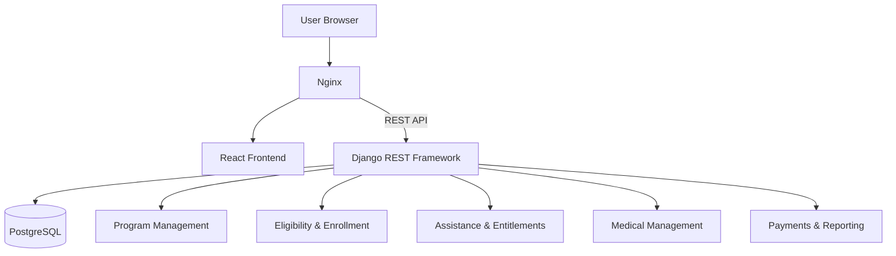

# H-CAP | Humanitarian Cash Assistance Platform

A full-stack web application for managing humanitarian assistance programs, from household registration and eligibility assessment to assistance allocation, distribution, monitoring, and reporting.

Built with **Django REST Framework, React, TypeScript, and PostgreSQL**, H-CAP provides an integrated platform for managing **cash assistance, non-food items (NFI), and medical assistance** through structured, role-based workflows.

The system focuses on operational transparency, data integrity, accountability, and efficient humanitarian aid management.

---

## Overview

H-CAP (Humanitarian Cash Assistance Platform) is designed to support organizations in planning, delivering, and monitoring humanitarian assistance.

The platform centralizes essential operations, including program configuration, beneficiary registration, eligibility verification, enrollment decisions, entitlement management, inventory tracking, and assistance distribution.

It demonstrates full-stack software engineering through RESTful APIs, relational database design, authentication and authorization, operational workflows, reporting, and Docker-based infrastructure.

---

## Key Features

### Program Management

- Create and manage humanitarian assistance programs
- Configure program budgets and activities
- Enable cash, NFI, and medical assistance workflows
- Track program status and operational progress
- Manage activity dependencies and program configurations

### Household Registration & Eligibility

- Register and manage household information
- Review and assess household eligibility
- Approve or reject enrollment requests
- Track enrollment decisions
- Manage beneficiary records through role-based access

### Cash Assistance & Payments

- Create cash entitlements for approved households
- Configure payment amounts and currencies
- Manage payment batches and instructions
- Simulate cash transfers through a built-in payment workflow
- Record payment statuses and reconciliation information

**Note:** The payment module uses a simulator. No real financial transfers are performed.

### Non-Food Item (NFI) Assistance

- Manage warehouses and inventory items
- Track stock quantities and movements
- Allocate NFI entitlements to eligible households
- Record assistance distributions
- Monitor allocation and delivery records
- Track distribution issues and discrepancies

### Medical Assistance Management

- Manage medical supplies and equipment
- Track medicines and medical product batches
- Record stock movements and distribution allocations
- Monitor medical entitlements
- Maintain equipment movement records
- Record temperature observations for sensitive products
- Monitor medical alerts and controlled-product authorizations

### Monitoring, Accountability & Reporting

- Record and manage beneficiary complaints
- Track distribution and delivery reviews
- Maintain audit records
- Generate program summaries and reports
- Support post-distribution monitoring (PDM)
- Manage data imports and registration synchronization

### AI & Automation

- Support advisory analysis and operational review workflows
- Assist with complaint analysis
- Maintain human review of AI-generated recommendations
- Support controlled automation-related workflows

**Human oversight:** AI and automation features do not independently make final eligibility, fraud, or payment decisions.

### User Interface & Access Control

- Responsive React and TypeScript frontend
- Role-based access to operational workflows
- JWT-based authentication
- User management and profile interfaces
- Operational dashboards
- Reusable components and structured forms

---

## Technology Stack

| Layer | Technologies |
|---|---|
| **Frontend** | React, TypeScript, Vite, Bootstrap |
| **Backend** | Python, Django, Django REST Framework |
| **Authentication** | JWT, Django REST Framework Simple JWT |
| **Database** | PostgreSQL |
| **ASGI Server** | Uvicorn |
| **Reverse Proxy** | Nginx |
| **Containerization** | Docker, Docker Compose |
| **Version Control** | Git, GitHub |

---

## System Architecture

H-CAP follows a client-server architecture. The React frontend communicates with Django REST Framework through Nginx, while PostgreSQL handles persistent data storage.



### Architecture Components

| Component | Responsibility |
|---|---|
| **React Frontend** | Provides dashboards, navigation, forms, and user interactions. |
| **Django REST Framework** | Handles API endpoints, business logic, validation, and permissions. |
| **PostgreSQL** | Stores program, household, financial, inventory, and operational data. |
| **Uvicorn** | Runs the Django ASGI application. |
| **Nginx** | Serves the React application and forwards API requests to the backend. |
| **Docker Compose** | Manages containers, networking, environment configuration, and persistent storage. |

---

## Project Structure

The application is divided into backend and frontend services, with Django applications organized by business responsibility.

```text
H-CAP/
│
├── backend/
│   ├── accounts/
│   ├── assistance/
│   ├── automation/
│   ├── config/
│   ├── medical/
│   ├── operations/
│   ├── payments/
│   ├── programs/
│   ├── reporting/
│   │
│   ├── manage.py
│   ├── requirements.txt
│   └── Dockerfile
│
├── frontend/
│   ├── src/
│   │   ├── api/
│   │   ├── components/
│   │   └── pages/
│   │
│   ├── Dockerfile
│   ├── nginx.conf
│   └── package.json
│
├── docker-compose.yml
├── docker-compose.dev.yml
├── .env.example
├── .gitignore
└── README.md
```

---

## Getting Started

### Prerequisites

Ensure the following tools are installed:

- Docker Desktop
- Docker Compose
- Git

### 1. Clone the Repository

```bash
git clone https://github.com/gaaferali/H-CAP.git
cd H-CAP
```

### 2. Configure Environment Variables

Create the environment file from the provided example:

```bash
cp .env.example .env
```

For Windows PowerShell:

```powershell
Copy-Item .env.example .env
```

Configure the required environment variables.

Example:

```dotenv
DJANGO_SECRET_KEY=replace-with-a-random-unique-secret-of-at-least-50-characters

DJANGO_ALLOWED_HOSTS=your-domain.example
CORS_ALLOWED_ORIGINS=https://your-domain.example
CSRF_TRUSTED_ORIGINS=https://your-domain.example

POSTGRES_DB=hcap
POSTGRES_USER=hcap
POSTGRES_PASSWORD=replace-with-a-long-random-database-password
```

Adjust the host, origin, and security settings for local development or the target deployment environment.

Never commit real credentials or `.env` files to version control.

### 3. Run with Docker

Build and start the application:

```bash
docker compose up -d --build
```

Check container status:

```bash
docker compose ps
```

View application logs:

```bash
docker compose logs -f
```

The default Docker Compose configuration exposes the application at:

**http://localhost**

### 4. Database Migrations

Apply Django database migrations when required:

```bash
docker compose exec backend python manage.py migrate
```

### 5. Stop the Application

```bash
docker compose down
```

Docker Compose preserves named volumes by default.

**Warning:** Running `docker compose down -v` also removes named volumes and may result in database data loss.

---

## API Overview

H-CAP exposes REST endpoints through the `/api/` prefix.

| Module | Example Endpoints |
|---|---|
| **Health** | `/api/health/` |
| **Programs** | `/api/programs/`, `/api/budgets/` |
| **Payments** | `/api/payment-batches/`, `/api/payment-instructions/` |
| **Operations** | `/api/warehouses/`, `/api/distribution-events/`, `/api/complaints/` |
| **Medical** | `/api/medical-products/`, `/api/medical-entitlements/`, `/api/medical-dashboard/` |
| **Reporting** | `/api/reports/`, `/api/pdm/`, `/api/audit-events/` |

API access depends on authentication requirements and user permissions.

---

## Database and Persistence

PostgreSQL serves as the primary relational database for the Docker-based application.

The database stores program information, household records, entitlements, inventory transactions, payment records, and operational data.

Database schema changes are managed through Django migrations.

Docker volumes provide persistent storage for PostgreSQL data and uploaded media independently of the container lifecycle.

---

## Testing and Verification

### Backend Checks

Run Django system checks:

```bash
docker compose exec backend python manage.py check
```

Run the available backend tests:

```bash
docker compose exec backend python manage.py test
```

### Frontend Checks

Navigate to the frontend directory and build the application:

```bash
cd frontend
npm install
npm run build
```

The frontend build checks TypeScript compilation and generates the production build.

---

## Security Considerations

The platform incorporates the following security mechanisms:

- JWT-based authentication
- Role-based authorization and access controls
- Backend request validation
- Environment-based secret management
- Configurable CORS and CSRF settings
- API rate-limit configuration
- User and operational audit records
- Docker network isolation for database services
- Human oversight of sensitive operational decisions

Production deployments should additionally review HTTPS configuration, secret management, database backups, and operational monitoring.

---

## Future Improvements

Potential future enhancements include:

- Integration with real payment providers
- Expanded offline synchronization for field operations
- Advanced reporting and analytical dashboards
- Additional automated and end-to-end testing
- Enhanced operational monitoring
- Deployment automation and infrastructure improvements
